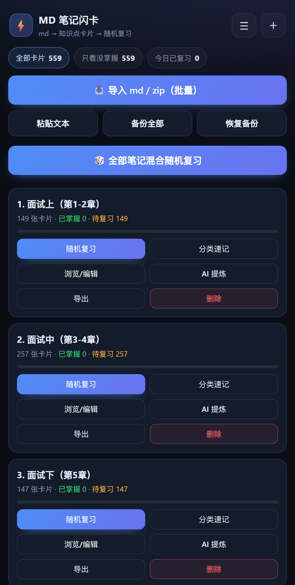
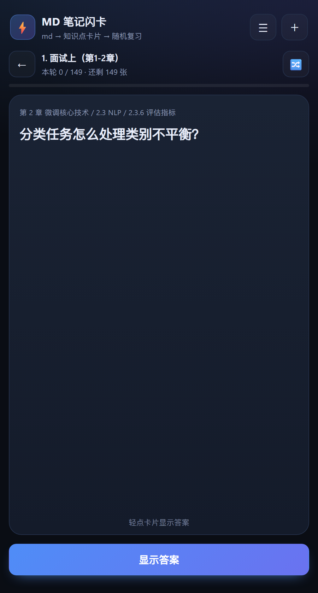
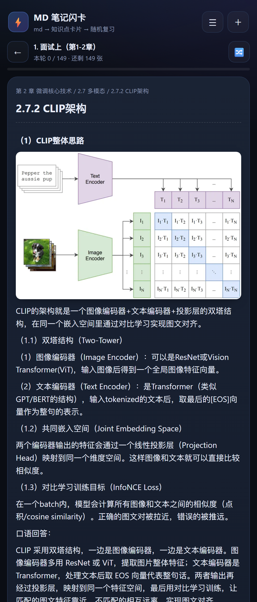
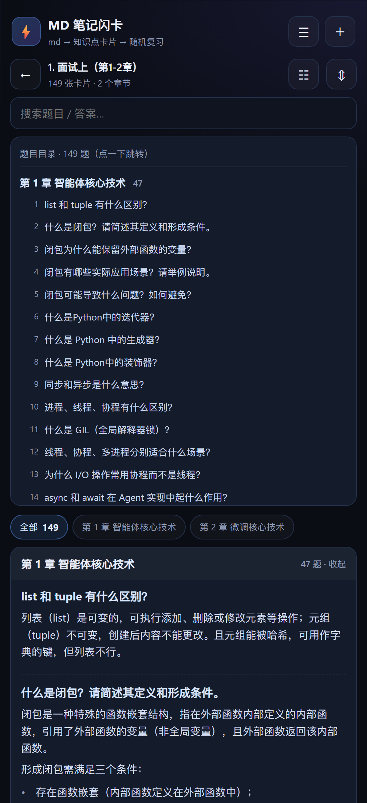

# MD Flashcards · 笔记闪卡

> 把一份很长的 md 笔记拆成一张张卡片，手机上随机抽背 / 分类速记。
> **纯本地、零安装、零后端、不需要服务器。**
> 本版本（Gitee）**不含内置题库**：导入自己的 md / zip 即可使用；题库生成脚本保留在 `scripts/`，用自己的资料可自行生成。



---

## 1. 它解决什么问题

| 现成方案 | 卡在哪 |
|---|---|
| AnkiDroid | 只认 `.apkg`，`.md` 必须先转换 |
| a-flash-deck | 只渲染卡内 Markdown，不吃 `.md` 文件 |
| NeuraCache / Obsidian 插件 | 能导入 md，但要装 App/插件、要按它的语法改笔记，多数是闭源 |
| Logseq / SiYuan | 开源，但 md 要"进库"、制卡要手工/换格式 |

这个工具只做一件事：**把一份很长的 md 笔记，拆成一张张卡，随机抽给你背**。不建库、不联网、不改你的原文件。

---

## 2. 三种用起来的方式

### 方式 0：本地验收（推荐 / 排查加载问题）

应用是单文件网页（本版本不含题库）：

| 文件 | 体积 | 说明 |
|---|---|---|
| `dist/md-flashcards.html` | 约 889 KB（含内联 KaTeX 与子集字体，以构建产物为准） | 唯一的构建产物，功能完整 |

**如果双击/预览打不开**，多半是预览器对中文路径有限制，改用本地 HTTP 服务：

```bash
# 在项目根目录
python -m http.server 8788 --directory dist
```

浏览器访问 **http://127.0.0.1:8788/** （单文件约 889 KB，Chrome/Edge 打开秒加载）。

### 方式 A：直接开网页（最简单）

1. 把 [`dist/md-flashcards.html`](dist/md-flashcards.html) 传到手机：微信/QQ 文件传输助手、数据线、网盘都行。
2. 用 **Chrome / Edge / 夸克** 打开（文件管理器里长按 → 打开方式 → 浏览器；如果看到源码，说明用错了打开方式）。
3. 点「📥 导入 md / zip（批量）」→ 选择文件 → 「导入全部」。
4. 浏览器菜单 → **添加到主屏幕**，以后像 App 一样打开。

> **打不开/白屏**：先换本地 HTTP 服务方式（方式 0）；文件不到 1 MB，基本不可能是体积问题。

> **图片**：导入时把 md 引用的图片一起选中即可（也支持 zip 打包、电脑端整文件夹）。支持标准 Markdown `` 和 **Obsidian 嵌入 `![[images/a.png]]`**（可带 `|宽度` 后缀），按**文件名**匹配引用（取 `a.png`），同名但内容不同的图片会**自动改名**（`a-2.png` / `a-3.png`）并按路径重写引用、不会覆盖已有图片，只存本机；「备份全部」会把图片一起打包成 zip，换机还原即可。
>
> **手机端只能单选文件？** 这是部分系统文件选择器（如 ColorOS）的限制，不是网页坏了：
> - 在导入弹层里**分几次**点「选择文件」，每次加一个，最后一起「导入全部」；
> - 或者把 md 和图片**在电脑上压成一个 zip**，手机端选这个 zip，网页在本地解压后批量导入。
>
> 数据存在浏览器本地（IndexedDB，失败时退化为 localStorage）。**清理浏览器数据会清掉卡片和进度**，记得用「备份全部」定期导出 zip（含图片）。

### 方式 B：手机访问电脑

```bash
# 项目根目录
python -m http.server 8000
```

手机连同一个 Wi-Fi，打开 `http://<电脑IP>:8000/dist/md-flashcards.html`。

### 方式 C：装 APK（Android）

项目自带 WebView 壳（`android/`），打包后就是一个真正的 App：可离线、能调系统文件选择器、备份直接写进「下载」目录。

**最简单：仓库根目录就有现成的 APK，直接下载安装**（debug 签名，安装时允许「未知来源」）：

- GitHub：`https://raw.githubusercontent.com/fest77/flash-memory-cards/main/MDFlashCards-v1.12.17.apk`
- Gitee：`https://gitee.com/festeel/flash-memory-cards/raw/main/MDFlashCards-v1.12.17.apk`

自己打包的其他方式：

- 有 Android Studio：打开 `android/` 目录，等 Gradle 同步完，`Build → Build APK(s)`；
- 没有 Android Studio：推到 GitHub 后由 Actions 自动构建（见 [§9](#9-打包成-apk)），在 Actions 页面下载 artifact；
- 或用任意机器（JDK 17 + Android SDK 34）执行：

```bash
python scripts/build.py            # 先把网页内联成 dist/md-flashcards.html
cd android && gradle assembleDebug # 产物：app/build/outputs/apk/debug/app-debug.apk
```

---

## 3. 它是怎么拆卡的

先按标题切段，再决定「题面怎么问」——两步都可以调。

### 3.1 拆分方式（切几段）

| 模式 | 规则 |
|---|---|
| **自动（推荐）** | 按标题层级选最合适的一层：**标题最多、且每节长度不超上限的最深一级**（如 `###` 有 3 节以上就按 `###` 拆）；标题太少或小节太长则退到更浅一级或按段落切；只有一个标题时整篇当一张卡 |
| 按二级标题 `##` | 每个 `##` 小节 = 一张卡 |
| 按三级标题 `###` | 每个 `###` 小节 = 一张卡 |
| 按问答 `Q:/A:` | `Q: ...` + `A: ...` 拆成一张卡，支持 `问：/答：`、`**题目：**`、`Q1:` 等写法 |
| 按分隔线 `---` | 每条分隔线之间 = 一张卡（第一行当题面） |
| 按段落 | 没有标题的纯文本笔记，按段落合并成 ~800 字一张卡 |

### 3.2 提问风格（题面怎么问）

| 风格 | 效果 |
|---|---|
| **提问式（推荐）** | 标题不是疑问句时按内容套模板，例如「三次握手」→「不看答案，说说「三次握手」的核心内容？」；含列表 →「包含哪几个要点？」；含对比表 →「关键差异是什么？」 |
| 标题式 | 标题当题面，不额外生成问题 |
| 挖空式 | 把答案里的**加粗词 / 行内代码**挖成横线，题面变成填空题；挖不出来退回提问式 |

规则细节：

- 标题本身已是疑问句（含 `？`、为什么/如何/区别/原理…）时，不再重复生成问题。
- 卡片粒度可调：**细 ≤800 字 / 中 ≤1600 字 / 粗 ≤3000 字**。
- **代码块里的 `##` 不会被误判成标题**；YAML frontmatter 会被跳过。
- 卡片 id 由「标题+题面+答案」内容哈希生成：**重新导入同一份笔记，已掌握进度会保留**。
- 本版本不含内置题库与配图；`（配图 imgXXX.png）` 占位符的渲染逻辑保留，如自行生成题库配图可复用（见 `scripts/build_interview_images.py`）。

### 3.3 让大模型来提问（可选，不需要服务器）

| 方式 | 怎么用 | 成本 |
|---|---|---|
| **A. 电脑脚本 + 任意 OpenAI 兼容 API（推荐）** | `python scripts/ai_cards.py --input D:/notes --out ai-cards.json --base ... --model ...`，传到手机后点「导入 AI 卡片」 | 云端 API 按 token 计费；**Ollama 本地模型免费** |
| **B. 网页里直接调 API** | 首页「AI 提炼设置」填地址/模型/key → 笔记卡片点「AI 提炼」 | 同上；浏览器直连常被 **CORS** 拦 |
| **C. 什么都不用** | 用上面的「提问式 / 挖空式」模板 | 免费、离线 |

**关于 CORS**：网页是纯前端，请求直接从手机发给所填 API。很多厂商（DeepSeek 等）不返回 CORS 头，浏览器会拒绝；这时用方式 A 的脚本即可（脚本在电脑跑，不受 CORS 限制）。本机 **Ollama** 也可给网页用：启动前设 `OLLAMA_ORIGINS=*`。

网页 AI 只改**题面**，不改答案，避免模型篡改知识内容；失败会保留原题面并提示。

---

## 4. 复习方式

**轻量间隔复习（Leitner 三盒）**：每张卡按「记住→盒数+1（间隔 1/3/7 天）/模糊→明天再见/忘了→立即到期」排期；旧卡和新卡视为今日到期。首页有「今日到期 N」计数；开始复习可选 **20 / 50 / 全部** 张、**只看薄弱卡**（答错过、或已复习过且仍在盒 1——没学过的新卡不算）、按**章节**筛选（多本笔记一起复习时无章节维度）。复习中途退出（返回、刷新、杀后台）后，首页出现「继续上次复习」，进度和队列原样恢复；有未完成会话时再开新复习会先询问；评分旁有**撤销上一张**。

- **随机洗牌**：每一轮打乱全部所选卡片（或多本笔记混合随机）。
- 先看题面回忆 → 点卡片 / 「显示答案」/ 空格。
- 自评：**😵 忘了 / 🤔 模糊 / 😎 记住了**（手机可左右滑动评价；键盘 `1 / 2 / 3`、`空格`、`Esc`）。
- 忘了/模糊的卡在本轮结束后自动进 **第 2 轮**。
- 「只看没掌握」过滤：只抽还没记住的卡。
- 浏览/编辑：搜索卡片、改标题/题面/答案、删卡、重置进度。

| 复习（未揭晓） | 揭晓答案 |
|---|---|
|  |  |

---

## 4.5 分类速记（按章节看完整问答）

不是考试，而是**按大纲读**：首页或管理页点「分类速记」→

- 顶部章节大纲（第 1 章 / 第 2 章 …），点一下只看该章；
- 右上角 **☷** 打开**题目目录**：两级「章 → 题」，一题一行，点哪题直接跳到那道题的完整问答（跳过去会高亮），长笔记不用翻；
- 按章节分组，**题目 + 完整答案直接展开**；
- 每组可折叠，右上角 ⇕ 一键展开/收起全部；
- 搜索框按题目或答案过滤，目录也会跟着筛。



---

## 4.6 笔记管理

点底部导航 **📚 笔记管理** 进入，每个笔记都支持：

- **分类速记**、**随机复习**
- 重命名（只改显示名，进度不变）、重置进度、导出、删除。

---

## 4.7 统计（闪记日志）

点底部导航 **📊 统计** 进入：

- 顶部三个小指标：**今日复习 / 累计复习 / 连续天数**；
- 中间的图默认是 **热力图**（GitHub 风格：一格一天，颜色越深复习越多，最近半年），可一键切换为 **条形图**（最近 7 天，每天一根柱）；
- **手指点 / 鼠标悬停**任意格子或柱子，会弹出「日期 + 当日复习次数」气泡；
- **年 / 月 / 日 选择器**（年份从 2020 起）：选定日期后，热力图与条形图窗口平移到以该日期为终点——热力图形态不变、选中格蓝框描边并滚到视野中央，条形图显示以该日结尾的 7 天；点「回到今天」恢复默认；
- 图表偏好会记住，下次打开还是你选的样子；数据来自每天的复习记录，只存在本机。

## 4.8 设置（主题 / 语言 / 关于）

点底部导航 **⚙️ 设置** 进入：

- **通用设置**
  - **主题**：深色（默认）/ 浅色；
  - **语言**：简体中文 / 繁體中文 / English，全界面即时切换（含提示语和确认框）。
- **AI 供应商**：支持同时配置多个供应商，随时启用 / 停用、切换「当前使用」。
  - 预置 **DeepSeek、Z.ai、Kimi、Bailian（阿里云百炼）、ChatGPT、Claude** 六家，在「＋ 添加供应商」里按需加入（地址和常用模型已预填，填上自己的 Key 即可用），不用的一直不占地方；
  - 也可添加**自定义供应商**（任何 OpenAI 兼容接口，如本机 Ollama）；Claude 走 Anthropic 原生协议，应用自动适配；
  - 每个供应商可维护**多个模型**（逗号分隔），并单独选择「当前模型」；
  - 每张卡有独立的「测试连接」。

**主页快捷切换**：首页的「🤖 AI 提炼 · 当前供应商 ▾」按钮点开即弹窗选择「供应商 · 模型」组合，不用进设置页；未配置时点它会引导去设置。

- **关于**：应用图标与名称（MD闪记卡 / MD FlashCards）、版本号、作者、反馈邮箱（fest1024@163.com）、**检查更新**（比对仓库版本清单，有新版询问是否前往下载）、Gitee / GitHub 仓库地址。

主题与语言保存在本机设置里，重启后保持。

> **隐私**：API Key 只保存在本机浏览器（IndexedDB），请求从本机直接发往对应厂商，不经任何服务器、不上传云端；「备份全部」导出的文件**不包含 Key**，换机后需重新填写。

---

## 5. 数据与备份

- 全部数据只在本机浏览器：`IndexedDB`（不可用时 `localStorage`）。v1.8.6 之前导入的旧笔记没有精确的小节分组信息（保持旧的粗粒度分组），删掉重新导入同一文件即可获得精确分组。
- **「导出备份」产出 zip**：`backup.json`（卡片 + 复习进度 + 每日统计）+ `images/`（本机全部图片）；不含 API Key。单篇笔记的导出仍是 json（带 `kind: deck` 标记，导入只新增该笔记，不含图片）。
- **导入支持 zip 和旧 json**：先显示预览（笔记/卡片/图片数、导出时间），再选**覆盖**（二次确认，整体替换）或**合并**（笔记按 id 匹配，冲突建「xx(导入)」副本；本地复习进度**不会被备份里的覆盖**，只补缺失）。任何一步失败都保留原数据。
- **图片同名不覆盖**：不同笔记里同名但内容不同的图片会自动改名（如 `img.png → img-2.png`）并重写当批笔记的引用；「设置 → 存储 → 清理未引用图片」可删掉没有任何卡片引用的图片（显示数量与占用）。删除笔记时也会自动清理。
- **图片显示不出来怎么办**：卡面出现「图片未导入：xxx」= 本地图库里没有这张图（重新导入 md + 图片）；出现「图片无法显示：xxx」= 文件在本地但浏览器解不出来（例如 HEIC，或 svg 的类型信息丢失）。「设置 → 存储 → 修复图片索引」会按本地实际存储重建索引并纠正图片格式信息，旧版本导入的 svg 多数可以这样一键恢复，无需删笔记重导。
- **备份提醒**：内容有改动且超过 7 天未备份时，首页出现可关闭的提醒条；支持的浏览器可在「设置 → 存储」选固定备份文件夹，之后一键写入带时间戳的 zip（不支持则退回普通下载；安卓端备份/分享走系统下载目录与分享面板）。

### 本期验收自测清单（v1.11.0）

- [x] 导出 zip → 清空应用数据 → 导入 zip：笔记、进度、每日统计、图片全部恢复且能显示
- [x] 已有 3 本导入 2 本的备份：预览数字准确；取消后数据零变化；合并后本地进度不被覆盖
- [x] 删除与另一本笔记共享卡片的笔记：另一本的进度仍在
- [x] 删笔记后「清理未引用图片」数量准确（无引用图片自动剔除）

### 第 3 期验收自测清单（v1.12.0）

- [x] 断网打开单文件 HTML：公式、代码高亮、图片全部正常（构建强制无外部资源引用；检查更新等运行时可选请求除外）
- [x] 全局搜索命中片段与来源笔记；卡片编辑/拆分/合并/移动后可撤销且刷新后仍在（写入 IndexedDB）
- [x] 题目生成语言跟随界面语言（简/繁/英三套模板）
- [x] 单文件体积增量控制在预算内（约 280 KB → 约 889 KB，KaTeX JS+CSS+12 个子集字体全部内联，以构建产物为准）
- [ ] 安卓分享 .md 导入 / PIN 锁定解锁 / 每日提醒：需真机验证（模拟器/CI 无法测系统分享与通知）
- 在 APK 里，备份会通过原生桥直接写进系统「下载/MD Flashcards」目录。
- 删除笔记/卡片只影响本机，**不会改你的原始 .md 文件**。
- AI 的 API Key 也只存本机，不上传。

---

## 6. 已知限制

- **没有 SM-2 / FSRS 记忆曲线**：这是"随机抽背 / 主动回忆"工具，不做间隔排期。要记忆曲线请用 AnkiDroid（配 mdankideck 转 apkg）或 Obsidian + Spaced Repetition。
- 单文件、单机；不做云同步（用 zip 备份换机）。
- 没有标题、没有分段、一整段几千字的笔记只能按段落切，卡片质量一般 → 建议补 `##` 小标题。
- 图片按文件名匹配、只存本机；「备份全部」会连图片一起打包，单本笔记导出不含图片（见导入章节）；引用了图片但没导入图片时，卡面显示「图片未导入」占位。
- 网页 AI 受浏览器 CORS 限制，不保证每个厂商都能直连（脚本方式不受限）。
- 老安卓浏览器（不支持 IndexedDB / DecompressionStream）会退化：前者用 localStorage，后者 zip 导入不可用（可改选 md 文件）。

---

## 7. 项目结构

```
md-flashcards/
├── README.md                 # 用户文档（本文件）
├── DEVELOPER.md              # 开发者文档：架构 / 数据模型 / 扩展指南
├── dist/
│   └── md-flashcards.html    # 构建产物（单文件，约 889 KB）
├── src/
│   ├── index.tpl.html        # 页面骨架 + 五个内联占位符
│   ├── core.js               # 纯函数：拆卡 / 提问 / Markdown 渲染 / zip 解包
│   ├── app.js               # 界面、存储、复习、速记、管理、AI、设置、多语言
│   └── styles.css            # 主题样式（深色默认 + 浅色，CSS 变量驱动）
├── scripts/
│   ├── build.py              # 内联构建 → dist/md-flashcards.html
│   ├── ai_cards.py           # 电脑端 md → AI 卡片 JSON
│   ├── build_interview_decks.py   # 题库 md → bundled-decks.js（可选，本版未含数据）
│   └── build_interview_images.py  # 题库配图 → bundled-images.js（可选，本版未含数据）
├── tests/
│   ├── core.test.cjs         # 65 项单元测试
│   ├── run-browser-test.cjs  # 187 项 headless Edge 端到端
│   ├── run-idb-test.cjs      # 38 项 IndexedDB 真实时钟回归（图片索引/类型/同名图/会话/复习重绘/导入去重/备份层级/超时连接/解压预算/每日统计合并/分享体积阈值/双写存储与取较新/导入换代图片）
│   ├── run-ui-test.cjs       # 10 项交互回归（大图缩放/平移/滑动/Esc 关闭、宽表格横向滚动、标题/提问公式、单本导出说明三语）
│   ├── run-screenshots.cjs   # 生成 docs/images 截图
│   └── fixtures/             # 测试用 zip
├── docs/
│   ├── images/               # 文档截图
│   └── research/             # 同类方案调研
├── android/                  # WebView APK 工程（Gradle）
└── .github/workflows/build-apk.yml
```

```bash
python scripts/build.py             # 构建单文件
node tests/core.test.cjs            # 单元测试
node tests/run-browser-test.cjs     # 浏览器冒烟测试（需要 Edge/Chrome）
node tests/run-screenshots.cjs      # 重新截图
python scripts/ai_cards.py --input <目录> --dry-run   # 只看切分，不调 API
```

> 架构、模块职责、数据模型与扩展指南见 **[DEVELOPER.md](DEVELOPER.md)**。

---

## 8. 和现成方案怎么选

| 你的情况 | 建议 |
|---|---|
| 只想把 md 拆开、随机背，不想装东西 | **本工具**（单文件网页 / APK） |
| 想要记忆曲线、长期复习 | **AnkiDroid** + [`mdankideck`](https://github.com/lukesmurray/markdown-anki-decks) 一次性转 `.apkg`（见 [docs/research/toolchain.md](docs/research/toolchain.md)） |
| 笔记本来就在 Obsidian，要卡片 + 间隔重复 | Obsidian 安卓 + [Spaced Repetition 插件](https://github.com/st3v3nmw/obsidian-spaced-repetition) |
| 想要完全开源、中文界面、笔记即 md | [Logseq](https://github.com/logseq/logseq)（`#card`）或 [SiYuan](https://github.com/siyuan-note/siyuan)（内置闪卡 + FSRS） |
| 想要零折腾但接受闭源 | [NeuraCache](https://neuracache.com/markdown-flashcards)（App 内 Import Markdown File） |

更完整的调研见 [docs/research/apps.md](docs/research/apps.md)。

---

## 9. 打包成 APK

`android/` 是一个最小 **WebView 壳**（纯 Java，零第三方依赖）：

- 通过手写 `shouldInterceptRequest` 以 `https://appassets.androidplatform.net/` 提供网页（不用 androidx），让 IndexedDB / localStorage 有稳定 origin；
- 实现 `onShowFileChooser`，手机端可一次选多个 md / zip；
- `AndroidSaver` 原生桥：备份 JSON 直接写进「下载/MD Flashcards」；
- **固定调试签名**：`android/debug.keystore` 随仓库管理（debug 密钥按 Android 惯例非机密），任何机器构建的 APK 签名一致，升级直接覆盖安装；对外分发请注意这是 debug 包
- 返回键优先关弹层 / 回上一页，再退出。

### 9.1 GitHub Actions（无需本地 SDK）

1. `git init && git add . && git commit -m "init"`
2. 在 GitHub 新建仓库并 push；
3. Actions 跑 **Build Android APK**，完成后在 run 页面下载 `md-flashcards-debug-apk`；
4. 手机安装 apk（debug 签名，安装时允许「未知来源」）。

也可以手动触发：仓库 Actions → Build Android APK → Run workflow。

### 9.2 本地构建

需要 JDK 17 + Android SDK（platform 34 / build-tools 34）：

```bash
python scripts/build.py
cd android
gradle assembleDebug
# 产物 android/app/build/outputs/apk/debug/app-debug.apk
```

发布版需自备签名：

```bash
keytool -genkeypair -keystore release.jks -alias mdflashcards -keyalg RSA -keysize 2048 -validity 10000
# 在 android/app/build.gradle.kts 里加 signingConfigs，然后 gradle assembleRelease
```

---

## 10. 内置题库（本版本未包含）

本仓库版本为了精简与版权考虑，**不包含任何内置题库数据**，打开即是空应用，导入自己的 md / zip 即可。

应用本身完整保留了题库装载能力：只要把题库数据放回 `src/bundled-decks.js`（与可选的 `src/bundled-images.js`）再重新构建，即可恢复「打开自带题库」的行为。生成脚本也一并保留：

```bash
export INTERVIEW_DIR="D:/path/to/interview-md"   # 含题库 md 与 images/ 配图目录
python scripts/build_interview_decks.py      # md → src/bundled-decks.js
python scripts/build_interview_images.py     # images/ → src/bundled-images.js（WebP）
python scripts/build.py                      # 内联 → dist/md-flashcards.html
```

题库 md 的预期排版：`# 第X章` 章节标题，题目用 `**（1）问题？**` 加粗疑问句标注，配图放 `images/` 对应子目录；具体规则见 `scripts/build_interview_decks.py` 头部注释。

---

## 11. 上传 GitHub 前

- 目录与文件名已全部改为英文（内容仍可为中文）；
- `.gitignore` 已排除 Android 构建产物、APK、签名文件、Python 缓存、测试临时文件；
- `dist/md-flashcards.html` 是需要提交的（GitHub Pages 可直接用它）；
- 想用 GitHub Pages：Settings → Pages → Source 选 `main` / `root`，访问 `https://<user>.github.io/<repo>/dist/md-flashcards.html`；
- 许可证按需添加（MIT / Apache-2.0 等）。

---

## 12. 版本历史

| 版本 | 变更 |
|---|---|
| 1.5 | 首个发布版：拆卡 / 随机复习 / 分类速记 / 管理 / 备份 / AI 提炼（BYO-key）/ Android 壳 |
| 1.6 | 设置视图（右上角 ⚙）：浅色主题（默认深色）、简繁英三语切换、关于页；dist 精简为单文件 |
| 1.7 | AI 多供应商管理（预置 DeepSeek/Z.ai/Kimi/Bailian/ChatGPT/Claude 按需添加 + 自定义，启停/多模型/测试连接），主页模型快捷切换弹窗，Claude 原生协议适配，备份文件不再包含 API Key |
| 1.7.2 | 导入支持图片：md+图片多选 / zip 含图 / 文件夹，图片存本机并按文件名渲染进卡面；Android 选择器放行图片 |
| 1.7.3 | zip 按内容识别（PK 魔数），改过名的 zip 也能导；「选择文件」按钮也能收 zip；关于页加反馈邮箱 |
| 1.8 | 底部导航（主页 / 笔记管理 / 统计 / 设置，移除右上角入口）；新增「统计 · 闪记日志」：GitHub 风格热力图（默认）+ 最近 7 天条形图可切换 |
| 1.8.3 | 支持 Obsidian `![[图片]]` 嵌入语法（含 `|宽度` 后缀）；卡面标题/题面/答案中的图片都能解析显示；Android 壳拦截 mailto: 等外部协议转交系统应用（修复点邮箱报 ERR_UNKNOWN_URL_SCHEME） |
| 1.8.4 | 审查修复：Q/A 识别要求分隔符（QPS/API 等不再被误拆）、Q/A 前导正文保留为概述卡、移除旧 WebView 白屏的后行断言正则、保存失败明确提示、备份恢复保留 AI 配置与主题语言、删除笔记清理进度、GBK 编码回退、固定 APK 签名（可覆盖安装）、外链转系统浏览器 |
| 1.8.5 | 二轮复核修复：快速阅读分组、概述卡命名（小节 · 概览）、flushSave 失败也提示、AI 提炼撤销入口移到首页（关窗后仍可撤销）、修复 kidQA 潜在崩溃、恢复识别 `Q1、`/`Q1.` 编号 |
| 1.8.6 | 三轮复核修复：新增 `chapter` 字段（所属小节）贯穿解析与存储，快速阅读分组不再把题面当章节；父小节前言 off-by-one 修复；AI 撤销失败如实提示；繁英补齐撤销文案 |
| 1.8.7 | 四轮复核修复：段落切块与整节切块分支的卡也写入 `chapter`（超长小节按段落切开后分组不再落回文档标题）；问答模式概览卡与题目卡统一归未分类；旧数据回退说明纠正（老笔记保持原有分组粒度，重导同一文件获得精确分组） |
| 1.9.0 | 应用内图标与桌面图标统一（渐变底白色闪电 SVG）；设置 → 关于新增「检查更新」（读仓库 latest.json 版本清单，「是」跳转 Gitee Releases 下载） |
| 1.10.0 | 轻量间隔复习（三盒排期、今日到期、20/50/全部、薄弱卡与章节筛选、继续上次复习、撤销上一张评分）；分类速记按完整路径分组（同名小节不合并）；按问答模式保留标题层级；关于页邮箱移到最下 |
| 1.10.1 | 复习链路小修：「待复习」口径不再吞到期卡（已掌握但今日到期仍计入）；多本「复习全部」也走设置弹窗；薄弱卡改为严格过滤（答错过或已学且在盒 1，新卡不算）；开新复习前对未完成会话先确认；空会话自动清理 |
| 1.11.0 | 数据安全与本地备份：zip 备份（含图片）+ 导入预览/覆盖/合并（进度不覆盖）+ 回滚安全；图片同名不覆盖与引用重写；无引用图片清理；删笔记不误伤共享卡进度；7 天备份提醒 + 备份文件夹一键写入；安卓 saveBinary/分享桥 |
| 1.12.1 | 修复：去除 MainActivity 重复成员、normalizeState 保留 tags/modified/阅读设置、公式不误判代码与货币、设置页重复存储段合并、备份改名写回引用、卡片操作迁移进度、通知权限与导入重试 |
| 1.12.2 | 修复：复制按钮从代码块容器取源码（pre 带 data-raw）、公式守卫排除英文价格与区间、清理未引用图片真正删除 Blob、删卡保留共享进度、导入/恢复清撤锚快照、旧编辑器重算 id 并迁移进度、PIN 清库等待完成、清单权限去重 |
| 1.12.3 | 修复：代码块二次转义（`&lt;` 以实体显示）、复制内容二次解码、PIN 忘记密码清库未闭环（先关连接再删库，blocked 不算成功）、文档体积统一 |
| 1.12.4 | 修复：忘记 PIN 清库成功后同时取消已排期的每日提醒与通知栏旧通知；文档测试数/体积/版本号统一 |
| 1.12.5 | 界面修复：首页排序下拉与筛选按钮留出间距；「存储」标题补繁體/英文翻译；设置-存储区改为纵向排布（按钮整行、输入框定宽），窄屏不再挤压；「应用锁」文案 PIN→密码（三语），该功能默认隐藏（手机系统自带应用锁，代码保留可恢复） |
| 1.12.6 | 界面修复：「继续上次复习」与「导入 md / zip（批量）」两个按钮之间留出 10px 间距（原来紧贴在一起）；没有未完成复习会话时该间距不出现，不额外占位 |
| 1.12.7 | 工程改进：发版流程自动化——推送 `v*` 标签后 CI 自动构建 APK、在 GitHub 与 Gitee 同时创建 Release 并上传附件、更新仓库根目录 APK 与版本清单（latest.json），发版不再需要手工八步 |
| 1.12.8 | 修复图片「未导入」：批量导入时并行写图会并发更新图片索引，导致索引丢失大部分条目，重启/更新后图片全部显示「图片未导入」，且重导同一个 zip 因「内容已存在」被静默跳过而修不回来。现在索引更新串行化、去重命中时自动补索引，并在启动时与「设置 → 存储 → 修复图片索引」里按本地实际存储重建索引（已损坏的图库可一键修回，无需删笔记重导） |
| 1.12.0 | 内容体验与平台能力：KaTeX 公式（本地内联子集字体）、代码高亮/复制、图片点击缩放、阅读设置（字号/行距/卡宽）；全局搜索、卡片编辑/拆分/合并/移动+撤销、标签与排序；Obsidian callout 与 wikilink 跳转、题目语言跟随界面；安卓接收分享导入、PIN 应用锁、每日本地提醒 |
| 1.12.9 | 与 1.12.8 同一批功能（图片索引修复）；此外修好了自动发版流程里发布说明文件被提前删除、导致 Gitee Release 上传失败的问题 |
| 1.12.18 | 缺陷修复（审计确认的 9 项）：① **导入队列遇到 `constructor`/`__proto__`/`toString` 这类文件名不再崩溃**（原型键污染普通对象，整批导入弹窗直接报错），同名文件仍按所在目录区分；② 首页 AI 快捷按钮把供应商名/模型名里的 HTML 转义后再显示，供应商名写成 `` 不再生成元素节点（备份预览里的版本号同样转义）；③ 安卓分享与图片桥改用 `android.util.Base64`（`java.util.Base64` 需要 API 26，而本应用 minSdk 24，API 24/25 上分享入口会直接崩）；④ 补齐三语缺失的 `card.splitHint` 文案（拆分弹窗原来直接露出 key 名）；⑤ 加载示例不再重置用户选好的拆分方式/粒度/题型（只有用户主动在粘贴弹层里选的参数才写回设置）；⑥ 样式表删掉一个多余的右花括号；⑦ 删除笔记/重命名笔记等笔记级操作会作废卡片撤销快照，撤销不再复活已删笔记或回滚名称；⑧ 保存同时写 IndexedDB 与 localStorage，重启时取两者中较新的一份（以前一次 IDB 写失败后，重启读到的永远是旧数据）；⑨ 批量导入的队列带批次代号，重开导入弹层后上一批未解压完的 zip 不会混进新队列，旧批次的图片也不再写进图库（不留下孤儿图）；构建脚本同时校验 CSS 花括号配平，防止多余的 `}` 让后续规则整段失效。新增 12 条浏览器端与 3 条 IDB 回归（浏览器 1 条为对照组，旧版也应通过），其余 14 条均先在 1.12.17 旧产物上复现失败 |
| 1.12.16 | 稳定性收尾：① 本地存储打开超时后迟到的连接会被主动关闭，避免「清空数据」被卡住；② 备份里字段不全的复习会话会被补齐（不再因缺字段导致首页白屏），残缺的撤销快照直接丢弃；③ 安卓「分享到本应用」单本笔记备份不再显示点了没反应的「覆盖」按钮；④ 删除笔记/卡片后自动作废指向它的复习会话，首页不再留点进去才发现失效的「继续上次复习」；⑤ 标签扫描跳过代码块并排除 `#123`/`#fff` 这类数字与颜色值；⑥ 题面与标题里的公式也能正常渲染，`~~~` 代码块里的 `$` 不再被当成公式；⑦ 检查更新增加 Gitee 兜底通道（走 API 并解 base64——Gitee 的 raw 地址不带跨域头，浏览器会直接拦掉）。新增 6 条 IDB 与 1 条交互回归，均先在 1.12.15 旧产物上复现失败 |
| 1.12.17 | 体积与合并语义：① 解压预算——单文件解压后 30 MB、整包累计 300 MB、条目数 2000、单条压缩比 100:1，任一超限立即中止并提示「文件过大，已停止解压」，声明尺寸不可信时按实际解压流量兜底（不再有解压炸弹把内存吃满）；② 合并备份的每日统计改为「只补缺失日期，不求和」，本地已有日期一律保留，重复合并同一份备份不会翻倍；③ 单本笔记导出说明补明「不含图片与其他笔记」（三语），导出格式不变；④ 安卓分享入口在读入内存前先按 300 MB 阈值拦截，超限直接提示。新增 3 条 IDB 与 1 条交互回归，均先在 1.12.16 旧产物上复现失败 |
| 1.12.15 | 交互与导入修复：① 洗牌/切语言后答案重新隐藏，但内部「已显示」状态没同步，导致答案再也打不开、空格却会直接评分——重画卡面时重置显示状态；② 图片第一次解码失败会换新地址重试，重试仍失败时改为「图片无法显示」占位，不再把 alt 文字撑成一屏；③ 大图打开时 Esc / 安卓返回只关大图（优先于底层弹窗），空格/1/2/3 不会误给复习卡评分；④ 浏览页与编辑弹窗里的图片可以点开大图；⑤ AI 导入同名笔记 JSON 先确认，取消时不丢旧卡与进度；⑥ 导入文件里的 deck/card id 统一转义，恶意 id 不能再注入页面；⑦ 文件夹导入遇到不同目录的同名笔记按文件夹区分（`a/note`、`b/note`），不再互相覆盖；⑧ 备份 zip 被解压再打包后，`images/` 在任意层级都能识别；⑨ 备份/导出文案与实际行为一致（整库备份含图片、单本导出不含图片）。新增 7 条 IDB 回归与 1 条 Esc 交互回归，均先在 1.12.14 旧产物上复现失败，再验证修复通过 |
| 1.12.14 | 细节收尾：① 按段落拆分时**代码块不再被内部空行切断**（长代码块整块保留、围栏成对）；② 只有表头的表格不再输出非法的 `</tbody>`；③ 代码块/行内代码里的 `[[…]]` 不再被误变成卡片链接；④ 全局搜索去掉失效的 60 条上限，界面显示 30 条并准确提示「另有 N 条匹配」；⑤ 新增防御性清理：确实评完（`rated >= total`）却残留「当前卡」的会话在打开首页时自动清掉，合法的「最后一张待评」不受影响；⑥ 同名图片无法判断归属时写入歧义标记，卡面显示「🖼 图片重名，无法确定」而不是随便显示一张；⑦ 导入弹层文案改为「自动改名并重写引用」（原来写的是「同名会覆盖」，与实现不符）；⑧ 图片入库异常时导入队列不再卡死；清理无用代码；CI 增加纯 Node 单测与可选浏览器回归 |
| 1.12.13 | 稳定性修复：① 复习做完整轮后**立即把「没有进行中的会话」写进本机**（原来重启后会冒出「继续上次复习：剩 1 张」，把刚评过的卡再放一遍、重复计入统计）；评分时先清「当前卡」再落盘，即使进程被杀也不会重显已评卡。② 文件夹/多选导入遇到同名图片时，按**相对路径**把改名后的引用写回 md（和 zip 导入一致），手机无目录信息时宁可不改也不猜。③ 本机数据库打开失败/超时会自动重试（原来一次失败会让整个会话的图片读写静默失效）。④ 撤销评分会同时把「今日复习数」减回去并落盘。⑤ 首页排序下拉跟随已保存的设置（刷新后不再显示回「最近导入」）。⑥ 历史遗留的坏图片记录（有键无内容）不再中断整批导入，直接覆盖修复 |
| 1.12.12 | 看图与表格体验：① 大图双击放大后**可以单指拖动平移**（原来只放大不能移），双指捏合改为连续缩放并把焦点固定在手指中间，缩放/平移都限制在可视范围内不会拖丢；② 未放大时**左右滑动即可退出大图**（跟安卓手势返回一致，带滑出动画），点空白处仍然可以关闭；③ **超宽表格底部可横向滚动**——表头和单元格有最小列宽、表格按内容宽度展开，列不再被挤成一条，窄表格保持原样不出现滚动条 |
| 1.12.11 | 修复图片「串图/错图」：笔记 zip 里不同子目录可以有同名图片（实测样本 251 张图里 87 张重名，如 `images/image上/img001.png`、`images/image中/img001.png`）。旧逻辑按文件名存图且并行写入，同名图片会互相覆盖（实测只存下 198 张，53 张丢失），随后又按文件名把整批 md 的引用统一改成最后一张——结果 215 处引用里 50 处拿到别人的图。现在图片改为串行入库（每张都能拿到 `img001.png` / `-2` / `-3` 独立名字），引用按 zip 内完整路径精确重写（同名且只写了文件名时保持原样，不猜），导入时若有图片保存失败会明确提示数量。用户侧：升级后**重新导入一次该 zip 并选「覆盖」**即可把已串错的旧笔记纠正过来 |
| 1.12.10 | 修复图片「内容异常」（卡面变成文件名）：Android 文件选择器/网盘/微信目录常把 svg 等文件报成 `application/octet-stream` 或空类型。浏览器对 PNG/JPEG 会按文件头嗅探照常显示，SVG 却只认 `image/svg+xml`，类型不对就整张解不出来。现在导入时按扩展名纠正存储的图片类型、启动/修复时按扩展名重建图片地址（旧数据无需重导即可恢复），「修复图片索引」会报告纠正了多少张；浏览器确实解不出的图改为显示「图片无法显示：文件名」占位，而不是把文件名撑成一张假图 |

